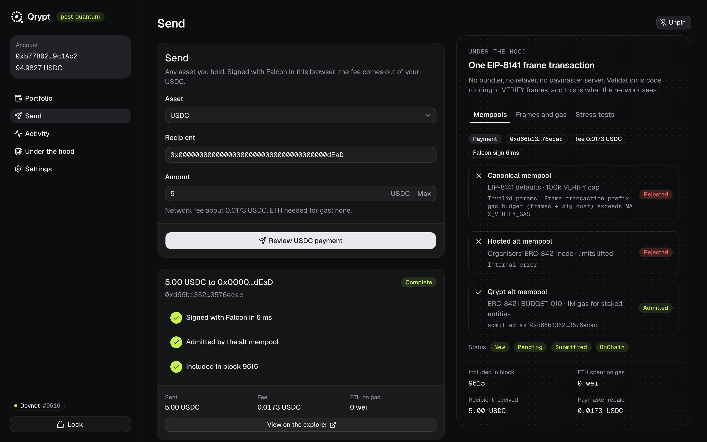
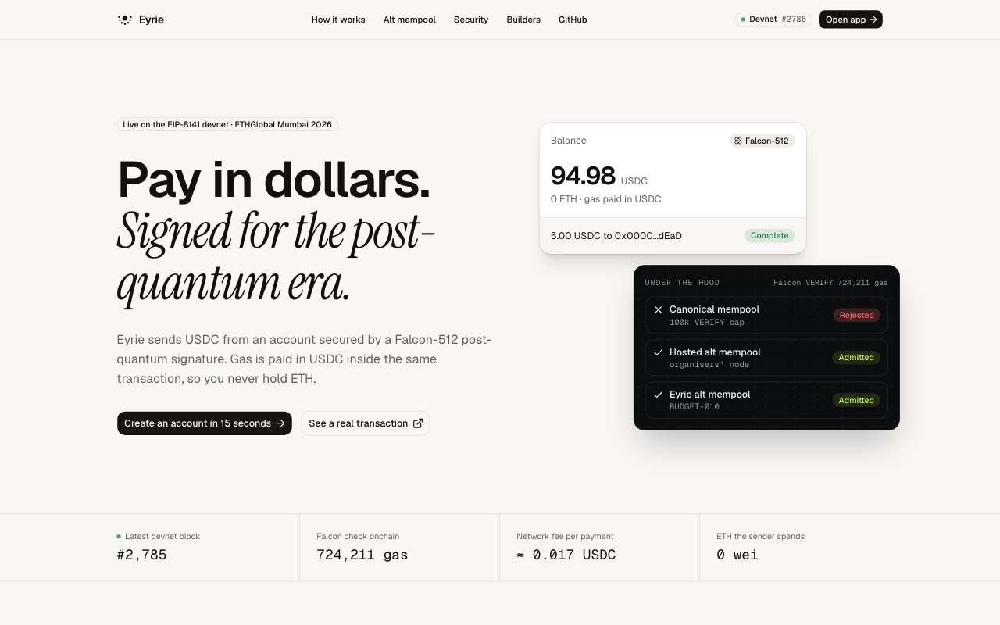

# Qrypt

**The post-quantum wallet on EIP-8141. Falcon-512 signatures, gas paid in USDC, zero ETH, zero middlemen.**

Qrypt was called Q-Pay, then Eyrie, while we built it, so the repo, the contracts (`QPayAccount` and the rest) and the `@qpay/*` packages keep the first name. Its home is [qrypt.money](https://qrypt.money).

Qrypt is a smart-account wallet whose only key is **Falcon-512**; there is no ECDSA key anywhere. Payments are its first job: a brand-new account that holds only USDC sends a payment. A permissionless paymaster pays the gas and takes it back **in USDC inside the same transaction**. There is no bundler, relayer or paymaster server: the validation rules are code running in VERIFY frames.

| | |
|---|---|
| **Canonical mempool** (EIP-8141) | **Rejects** it: the Falcon check costs about 0.7M gas, over the 100k validation cap, and the paymaster reads storage outside `tx.sender` |
| **Alternative mempool** (ERC-8421) | **Admits** it, under the per-entity validation budget (BUDGET-010) we implemented in the sidecar: the staked account gets up to 1M, and the unstaked paymaster stays under 100k |

Built at ETHGlobal Mumbai 2026 for the Ethereum Foundation "Best use of the Frame Transaction Alternative Mempool" prize. Its brief names PQ-secure smart wallets and ERC-20 paymasters. Qrypt does both in one transaction.





## Proof it runs on the public devnet

| | |
|---|---|
| Transaction | `0x18bde9fdb212daad6c5f197d13e0e84d67766b92d56e5d4b4e399832b8ad9c3b`, included in **block 726** of the public alt-mempool devnet (chain 1337), status success |
| Admitted by | our ERC-8421 sidecar with BUDGET-010: [fork branch](https://github.com/yashj09/mempool-workshop-sidecar/tree/budget-010), [upstream PR](https://github.com/forshtat/mempool-workshop-sidecar/pull/2) |
| Rejected by the stock alt mempool | [explorer record on the official Gateway node](https://explorer.altmempool.wtf/tx/0x18bde9fdb212daad6c5f197d13e0e84d67766b92d56e5d4b4e399832b8ad9c3b?node=https%3A%2F%2Faltmempoolgateway.forshtat.com%2Frpc): `1050100 exceeds MAX_VERIFY_GAS 100000` ([screenshot](docs/media/explorer-stock-rejection.png)) |
| Rejected by the canonical mempool | ethrex: `Frame transaction prefix gas budget (frames + sig cost) exceeds MAX_VERIFY_GAS` |

Check the receipt yourself:

```sh
cast receipt 0x18bde9fdb212daad6c5f197d13e0e84d67766b92d56e5d4b4e399832b8ad9c3b --rpc-url https://altmempool.forshtat.com
```

The devnet can be reset at any time. If it has been, `pnpm setup` and `pnpm send` reproduce the result in a few minutes; see [docs/runbook.md](docs/runbook.md).

### Measured numbers

| What | Value |
|---|---|
| Frame 0, Falcon-512 VERIFY (account, staked) | 676k–724k gas, 6.8–7.2x the canonical 100k cap. The cost varies per signature |
| Frame 1, paymaster VERIFY (unstaked) | 27,922 gas, inside the unstaked 100k budget |
| Frame 2, repay gas in USDC | 25,012 gas |
| Frame 3, the payment | 15,012 gas |
| Whole transaction | about 821k gas |
| Gas fee, paid in USDC | 0.0169 USDC at the devnet's suggested gas price (about 0.002 gwei) |
| Falcon signing in the browser | 3–7 ms |
| Sender's ETH before and after | 0, then 0 |

## The wallet

| Feature | How |
|---|---|
| Send and receive any asset | USDC, ETH and any ERC-20 you add. Receive shows your address as a QR code. Activity is read from chain logs, including ETH through the devnet's EIP-7708 transfer logs |
| Gas in USDC | Every transaction is `[Falcon VERIFY, paymaster VERIFY, repay USDC, ...your calls]`. The paymaster only checks the frame after it, so the calls can be anything |
| Browser extension | A full wallet in the toolbar (Talisman-style): balance, assets, send, receive, activity, and a **Fullscreen** dashboard tab with under the hood, connected sites and settings. The Falcon key lives in an encrypted vault: password unlock, auto-lock after 15 idle minutes, Touch ID where the browser supports WebAuthn PRF. Dapps find it through EIP-6963 and approve in the extension's own window |
| Connect without installing | An EIP-1193 provider opens the web wallet's `/connect` page in a popup. Try both ways at [/dapp](https://qpay-psi.vercel.app/dapp) |
| Sign in with Qrypt | `personal_sign` and `eth_signTypedData_v4` return a Falcon signature over the EIP-191/712 hash; the account's `isValidSignature` (ERC-1271) checks it onchain |
| On your phone | Below 768 px, `/app` becomes a phone wallet: a dollar balance, Receive / Send / Scan tiles, a number-pad send, payment-request QR codes and pay links (`/pay?to=…&amount=…`), scan to pay with the camera or a photo, and an "Under the hood" sheet. It installs to the home screen as a PWA |
| Face ID unlock and recovery | The web wallet's key sits in an encrypted vault, unlocked by Face ID / Touch ID (a passkey's WebAuthn PRF) or a password, and locks after 15 idle minutes. With Face ID, an encrypted copy is saved to our server, so a new phone recovers the account with one Face ID prompt. The server only holds ciphertext, and only the account's own Falcon key can write it |
| Payment notifications | Turn them on in Settings and a push arrives when USDC, a token or ETH comes in, even with Qrypt closed. On iPhone this needs the home-screen app |
| Back up and restore | A password-encrypted file (PBKDF2-SHA-256, 600k rounds, AES-GCM), made and read in the browser. Restore checks onchain that the key still controls the account |
| Rotate the key | A transaction signed by the current key calls `rotateKey`, which only the account itself can call. The old key and old backups stop working |
| Close the account | One transaction unlocks and withdraws the stake and sweeps every balance to an address you choose |

**Install the extension:** download [qrypt-extension.zip](https://qpay-psi.vercel.app/qrypt-extension.zip), unzip it, open `chrome://extensions`, turn on Developer mode and choose "Load unpacked". (From a clone: `pnpm --filter app build:extension`, then load `extension/dist`.) Onboarding opens by itself: create a wallet or import a backup file from the web wallet. It isn't in the Chrome Web Store.

## Live demo for judges

**https://qpay-psi.vercel.app** is the landing page. **https://qpay-psi.vercel.app/app** creates your own post-quantum account in your browser and sends USDC with 0 ETH. Open `/app` on a phone for the phone wallet, and add it to the home screen for notifications. **https://qpay-psi.vercel.app/dapp** is a demo third-party dapp: connect, sign in (verified onchain by ERC-1271) and claim test euros through Qrypt. The Falcon key never leaves your device. Our BUDGET-010 sidecar runs on the presenter's laptop behind a tunnel. If it's offline, the organisers' hosted alt mempool still carries the transaction.

**Is a 700k-gas VERIFY frame fair to mempool nodes and builders?** Yes, with measured numbers, and without breaking CROPS: see [docs/mempool-safety.md](docs/mempool-safety.md).

## How it works

See [docs/architecture.md](docs/architecture.md) for the full picture. In short:

1. The app builds the frames: the account's VERIFY (Falcon), the paymaster's VERIFY (USDC repayment check), a SENDER `usdc.transfer(paymaster, fee)`, then one SENDER frame per call. A payment is one call, `usdc.transfer(recipient, amount)`; a dapp's `eth_sendTransaction` is one call to whatever it asked for.
2. It signs the frame transaction's signature hash with Falcon-512 in the browser, and puts the 1064-byte signature in an ARBITRARY signature entry. That entry is left out of the hash.
3. `QPayAccount` reads the hash (`TXPARAM`) and the signature (`SIGDATACOPY`) inside its VERIFY frame, checks them with the ZKNOX falcon8 verifier, and approves execution.
4. `UsdcPaymaster` introspects the next frame (`FRAMEDATALOAD`), checks the fee against `TXPARAM.MAX_COST` and checks the sender's USDC balance, then approves payment.

## Run it

Requirements: Node 24, pnpm, Foundry, bun (for the sidecar).

```sh
pnpm install
pnpm build:contracts && (cd contracts/falcon && forge build)

# deploy to the public alt-mempool devnet (chain 1337)
QPAY_NODE_RPC=https://altmempool.forshtat.com pnpm setup

# run the ERC-8421 sidecar with our BUDGET-010 patch against that node
git clone -b budget-010 https://github.com/yashj09/mempool-workshop-sidecar ../sidecar && (cd ../sidecar && bun install && bun run build)
QPAY_NODE_RPC=https://altmempool.forshtat.com SIDECAR_DIR=../sidecar ./devnet/sidecar.sh

# end to end from the CLI
QPAY_NODE_RPC=https://altmempool.forshtat.com pnpm send 0xRecipient 5
QPAY_NODE_RPC=https://altmempool.forshtat.com pnpm send 0xRecipient 5 --tamper   # rejected at VERIFY

# the demo app
QPAY_NODE_RPC=https://altmempool.forshtat.com pnpm app

# after changing QPayAccount: redeploy only the factory layer (factory, tEUR, demo account)
QPAY_NODE_RPC=https://altmempool.forshtat.com pnpm deploy:account

# rebuild the extension zip the landing page serves
pnpm pack:extension
```

`devnet/up.sh` starts a local ethrex and Lighthouse devnet through Kurtosis, as an alternative to the public one.

## Tests

```sh
cd contracts/falcon && forge test   # noble Falcon signatures verify; tampering is rejected
pnpm test:contracts                  # account v2: receive ETH, rotateKey only from itself, ERC-1271
pnpm test:web                       # the web wallet: onboard and send
pnpm test:passkey                    # Face ID (Chromium's virtual WebAuthn authenticator with PRF): create, lock, unlock,
                                     # send, wipe and recover, rotate then recover again, forged recovery upload refused
pnpm test:mobile                     # iPhone 15 profile: installable PWA, keypad send, pay link, scan a QR, shortcuts
pnpm test:push                       # one phone turns on notifications, another pays it, the push watcher delivers
                                     # "Received 1.00 USDC" through the real push service
pnpm test:pay-request                # pay link / EIP-681 / address parsing
pnpm test:extension                  # needs `pnpm app` running (for /dapp): Playwright Chromium loads extension/dist,
                                     # onboards with a password, locks/unlocks, sends from the popup, connects a dapp
                                     # (EIP-6963), signs in (ERC-1271), claims tEUR, rotates, backs up, imports, sends
```

## Trade-offs and limits

- The Falcon verifier is ZKNOX's experimental, unaudited `falcon_core8` (ETHFALCON `012e080`), behind our adapter. It costs 590k–640k gas per verify.
- The account stakes 0.02 ETH, which is refundable, so its expensive validation gets the staked budget. Its spendable ETH is 0.
- The paymaster charges on the transaction's maximum cost, not on gas actually used. A post-op refund frame would fix this.
- The sidecar rule is a patch on the workshop sidecar. ERC-8421 BUDGET-010 is still a draft, and its numbers may change.
- The Falcon key lives in the browser, encrypted. Face ID recovery depends on our Blob store and on the passkey surviving in iCloud Keychain; the backup file covers both. Someone who takes over your iCloud account could recover the key, the same trade-off as Coinbase Smart Wallet; password-only mode avoids it. There are no guardians or social recovery.
- Face ID needs passkeys bound to `qrypt.money`, so it's offered there and on localhost only. Other hosts get the password vault.
- Payment notifications come from a watcher on the presenter's laptop, like the sidecar. If it's off, no pushes arrive; nothing else breaks.
- The extension is loaded unpacked. It fetches `/api/config` and `/api/onboard` from the hosted site, so creating an account needs that site reachable; signing and sending don't.
- The web wallet and the extension hold separate keys. An account moves between them only through a backup file.
- The fee bound adds 2% over our model of `max_cost`, because the chain's accounting has terms we don't model exactly. That's about 0.0003 USDC per transaction.

## Built on

ethrex `eip8141-tracer` (devnet), forshtat/mempool-workshop-sidecar (ERC-8421 sidecar), `@forshtat/hegota-support` (frame opcodes from Solidity), ZKNoxHQ/ETHFALCON (Falcon verifier), `@noble/post-quantum` (Falcon signer), viem, Foundry, Vite, React, shadcn/ui.

## AI usage

Built with Claude Code (Anthropic) as the coding agent, directed by the author:

- **Research and planning.** Claude Code gathered the protocol, tooling and prize research. `docs/plan.md` and `docs/decisions.md` record the plan and the decisions, and every major decision was approved by the author.
- **Code.** Claude Code wrote most of the code in `contracts/`, `packages/`, `scripts/`, `app/` and `sidecar/budget-010.patch`. The author reviewed it, ran it and decided how it should work.
- **Spike.** A Claude Code subagent ran the Falcon round-trip spike, whose results became `contracts/falcon/` and `packages/falcon/`.
- **Commits.** Each commit carries a `Co-Authored-By: Claude` trailer.

## License

MIT
